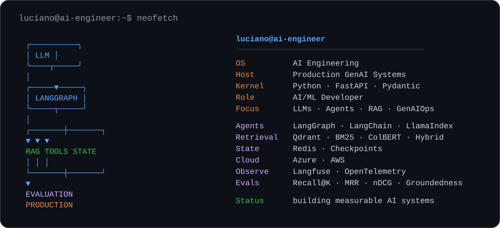

<div align="center">



**AI/ML Developer · GenAI Engineer · Agentic Systems**

`LLMs` · `AI Agents` · `RAG` · `Evals` · `Observability` · `GenAIOps`

[English version](README.en.md)

</div>

## Sobre

Construo aplicações de LLM e agentes de IA que possam ser **avaliadas, observadas e operadas com segurança em produção**.

Meu foco está na camada de engenharia entre um protótipo com LLM e um sistema confiável: recuperação, estado, ferramentas, outputs estruturados, guardrails, observabilidade, avaliação e resiliência.

> **Sistema de IA que não pode ser medido não deve ser tratado como confiável em produção.**

## Projetos em destaque

### [Forgehand](https://github.com/lucianoon/forgehand) — engenharia de agentes

Plataforma multiagente para entrega de software com fan-out paralelo, execução durável, gates humanos e judge LLM subordinado a verificações objetivas como `pytest`, `ruff` e `mypy`.

- **Operação:** circuit breakers de custo, tempo e tentativas; tracing com OpenTelemetry/Langfuse
- **Confiabilidade:** checkpoints em PostgreSQL e retomada após interrupções
- **Evidência:** [piloto reproduzível com metodologia e limitações](https://github.com/lucianoon/forgehand/blob/main/docs/pilot-report-2026-07-20.md)

### [EdgeVision](https://github.com/lucianoon/edgevision) — visão computacional em tempo real

Detecção e rastreamento multicâmera levados de um baseline em PyTorch a um runtime C++/CUDA, com cada otimização justificada por uma medição.

- **Pipeline:** NVDEC → kernel CUDA de pré-processamento → TensorRT FP16 → ByteTrack em C++
- **Desempenho (Tesla T4):** 2,0 ms por frame, 675 fps agregados, 12 câmeras RTSP a 25 fps sem perda
- **Evidência:** mAP COCO 0,372 no pipeline TensorRT FP16 @ 512 (referência FP32: 0,404 @ 640), benchmarks por etapa e custo total de GPU de ~US$ 8

### [Aplicaí — Gestor de Liquidez Itaú](https://github.com/lucianoon/aplicai) — agentes com guardrails

Assistente financeiro multiagente da Batalha de Agentes (Itaú Unibanco + Google): projeta 30 dias, reserva as contas e rende só a sobra, com a IA conversando, o código calculando e o cliente aprovando.

- **Arquitetura:** Google ADK 2.x, com guardrails antes/depois do modelo e antes de cada ferramenta
- **Confiança:** autorização assinada HMAC-SHA256 (60 s, uso único), execução idempotente e trilha de auditoria
- **IA responsável:** LGPD, CVM 30 e Lei 14.181 como requisitos de design, não como rodapé
- **Evidência:** 156 testes automatizados, ADRs documentados

### [Enterprise RAG System](https://github.com/lucianoon/enterprise-rag-system) — retrieval mensurável

Pipeline de RAG com busca híbrida, reranking e métricas por estágio para separar falhas de retrieval de falhas de geração.

- **Retrieval:** embeddings + BM25 + reranking
- **Avaliação:** Recall@K, MRR, nDCG e groundedness
- **API:** [documentação interativa](https://enterprise-rag-demo.onrender.com/docs)

### [mcp-dados-br](https://github.com/lucianoon/mcp-dados-br) — ferramentas para agentes

Servidor MCP para consultar dados públicos brasileiros a partir de agentes e assistentes de IA.

- **Fontes:** IBGE, Banco Central, INMET, Câmara dos Deputados e Senado Federal
- **Engenharia:** cache, retry, transporte stdio/HTTP, testes offline e Docker
- **Distribuição:** `uvx mcp-dados-br`

### [llm-course](https://github.com/lucianoon/llm-course) — curso de engenharia de LLMs

Curso aberto em português para entender, customizar, avaliar e servir modelos de linguagem, do zero à produção, com laboratórios que tornam as hipóteses mensuráveis.

- **Currículo:** Fase 0 + 19 módulos e 36 scripts de laboratório; a rota inteira roda em CPU
- **Percurso:** atenção e transformer do zero, SFT, LoRA, RAG, avaliação, agentes e servir em produção
- **Evidência:** repositório mais estrelado do perfil (18 stars); [registro de alegações, reproduções e limites](https://github.com/lucianoon/llm-course/blob/main/EVIDENCIAS.md)

### [sdd-kit](https://github.com/lucianoon/sdd-kit) — spec-driven development

Specification-Driven Development para desenvolvimento assistido por IA, com verificação por ferramentas independentes do LLM.

- **Contrato:** o agente escolhe como implementar; a spec define o que é correto; o `sdd` decide se está pronto
- **Verificação:** `check`, `diff`, mutação e evals estatísticos fora do agente; o próprio kit se verifica com onze specs
- **Distribuição:** publicado no [PyPI como `sdd-kit-ai`](https://pypi.org/project/sdd-kit-ai/) (`pipx install sdd-kit-ai`)

## Engenharia de produção

```text
Retrieval      → medir Recall@K, MRR e nDCG
Agent state    → controlar estado e checkpoints
LLM output     → validar outputs estruturados
Tools          → timeout, retry e idempotência
Observability  → traces, custo, latência e falhas
Evaluation     → groundedness + LLM-as-a-Judge
Deployment     → API, containers, CI/CD e cloud
```

## Stack principal

```text
Language       Python · SQL
Backend        FastAPI · Pydantic
Agents         LangGraph · LangChain · LlamaIndex · Google ADK
Retrieval      Qdrant · BM25 · ColBERT · SentenceTransformers
Vision         PyTorch · ONNX · TensorRT · CUDA · C++
State/Data     Redis · PostgreSQL · SQLAlchemy
Cloud          AWS (Bedrock · SageMaker · S3) · Bedrock AgentCore
Infra          Docker · GitHub Actions (CI/CD) · Render
Observability  Langfuse · OpenTelemetry · Prometheus · Grafana
```

Cada linha acima tem código correspondente nos repositórios deste perfil. O que
ainda não está aqui é o que ainda não foi construído.

## Princípios

```python
engineering = {
    "retrieval": "measure it",
    "state": "control it",
    "output": "validate it",
    "production": "observe it",
    "failure": "design for it",
}
```

<div align="center">

**Building AI systems that can be measured before they are trusted.**

[LinkedIn](https://www.linkedin.com/in/luciano-oliveira-nunes/) · [GitHub](https://github.com/lucianoon)

</div>
